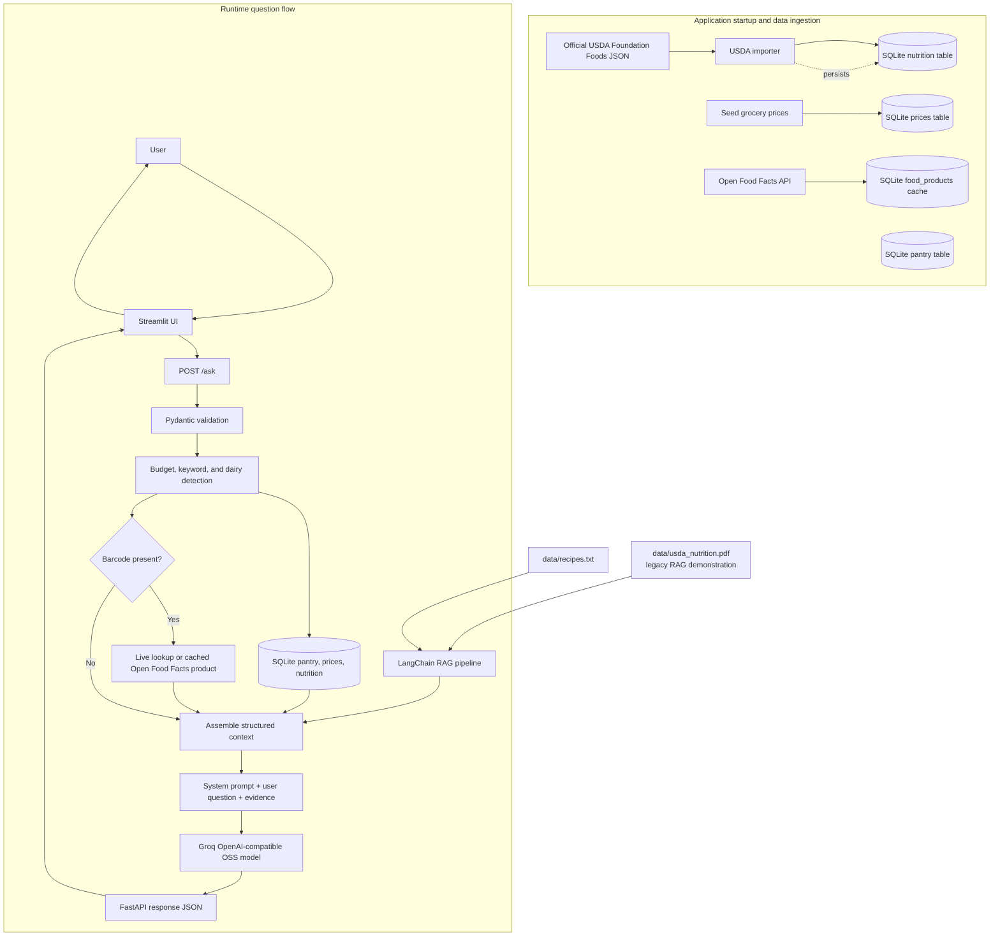
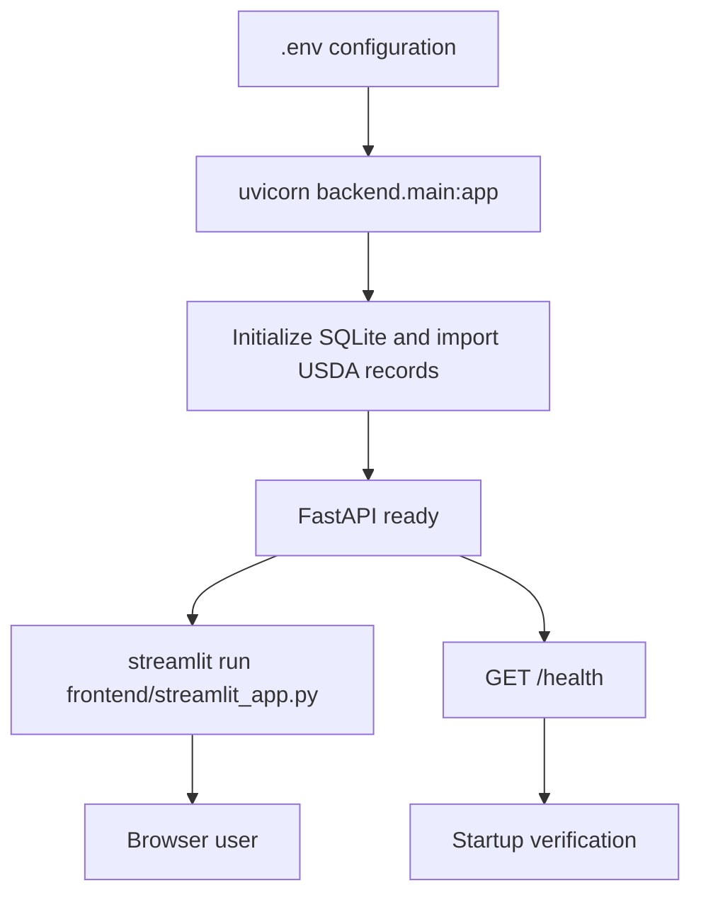

# 1. Title Page

<div align="center">

## End Semester Examination Project Report

### Personalized Nutrition & Grocery Bot

<br>

**Course:** [Course Name]  
**Submitted by:** [Your Name / Roll Number]  
**Institution:** [Your College Name]  
**Date:** 3 November 2026

<br><br>

### Executive Summary Metrics

| Metric | Measured result |
|---|---:|
| Total end-to-end latency | **52,926.384 ms** |
| SQLite pantry and price query | **2.896 ms** |
| ChromaDB retrieval query | **46,921.390 ms** |
| LLM inference/network round trip | **6,002.091 ms** |
| LLM execution mode | **Provider API** |

</div>

---

# 2. Index

1. [Title Page](#1-title-page)
2. [Index](#2-index)
3. [Abstract](#3-abstract)
4. [Introduction](#4-introduction)
   1. [Background](#41-background)
   2. [Problem Statement](#42-problem-statement)
   3. [Objectives](#43-objectives)
   4. [Scope](#44-scope)
   5. [Technical Challenges & Solutions](#45-technical-challenges--solutions)
5. [Application Workflow](#5-application-workflow)
   1. [System Architecture](#51-system-architecture)
   2. [End-to-End Request Flow](#52-end-to-end-request-flow)
   3. [Data Flow & Performance Metrics](#53-data-flow--performance-metrics)
   4. [Technology Responsibilities](#54-technology-responsibilities)
   5. [Model Configuration](#55-model-configuration)
   6. [External and Local Data Sources](#56-external-and-local-data-sources)
   7. [User Interface and Constraint Handling](#57-user-interface-and-constraint-handling)
   8. [Complete Processing Flows](#58-complete-processing-flows)
   9. [Persistence and Index Refresh](#59-persistence-and-index-refresh)
6. [Results & Observation](#6-results--observation)
   1. [Benchmark Methodology](#61-benchmark-methodology)
   2. [Exact Benchmark Output](#62-exact-benchmark-output)
   3. [Ingredients and Nutrition](#63-ingredients-and-nutrition)
   4. [Pricing Analysis](#64-pricing-analysis)
   5. [Critical Analysis](#65-critical-analysis)
   6. [Integration Verification](#66-integration-verification)
7. [Conclusion](#7-conclusion)
8. [Links & References](#8-links--references)

---

# 3. Abstract

The Personalized Nutrition & Grocery Bot is a grounded artificial-intelligence application designed to generate meal recommendations subject to dietary, financial, and inventory constraints. Conventional large language models can produce fluent recipes, but they may hallucinate grocery prices, ignore pantry contents, or recommend ingredients that conflict with allergies. This project addresses those limitations through a hybrid architecture composed of Streamlit, FastAPI, SQLite, ChromaDB, LangChain, USDA FoodData Central Foundation Foods, Open Food Facts, and an OpenAI-compatible language-model provider. Streamlit provides the user-facing workspace for budget entry, pantry management, and natural-language questions. FastAPI orchestrates request processing and combines structured database results with retrieved nutrition knowledge. SQLite supplies deterministic pantry and price records, imports 424 USDA Foundation Foods records, and caches external product lookups. Open Food Facts supplies live barcode-based product data, while LangChain and ChromaDB retrieve semantically relevant recipe and nutrition passages. The default generation model is Groq's OpenAI-compatible open-weight `openai/gpt-oss-20b`. A benchmark executed against the earlier provider-backed configuration measured a SQLite query latency of **2.896 ms**, ChromaDB retrieval latency of **46,921.390 ms**, provider LLM latency of **6,002.091 ms**, and total end-to-end latency of **52,926.384 ms**. The experiment demonstrates that structured retrieval is fast, whereas first-use embedding initialization dominates the measured request. The system therefore provides a practical foundation for safer and more personalized meal planning, while also exposing measurable optimization opportunities in retrieval initialization and deterministic cost accounting. These measurements support evidence-based engineering decisions for optimization, validation, deployment, reproducibility, and scaling in production.

---

# 4. Introduction

## 4.1 Background

Food planning is a constraint-satisfaction problem rather than a simple text-generation task. A useful recommendation must account for the user's dietary restrictions, available ingredients, budget, nutrition goals, cuisine preferences, and preparation context. For example, a user may request a high-protein dinner under a fixed budget while also reporting a dairy allergy and asking the assistant to use ingredients already available in the pantry.

The Personalized Nutrition & Grocery Bot was developed to address this problem through a web-based conversational application. It combines deterministic software components with generative AI. The deterministic components provide facts that must be accurate, such as pantry inventory and stored price records. The retrieval component provides relevant recipe and nutrition information from project documents. The language model then converts these grounded inputs into an understandable response.

## 4.2 Problem Statement

The central problem is:

> How can a conversational nutrition assistant produce useful, allergy-aware and budget-conscious meal plans while accurately incorporating structured pantry data and unstructured recipe knowledge?

An answer based only on a language model is insufficient because the model does not automatically know the user's current pantry or the application's price records. It may also treat an allergy as a soft preference rather than a hard safety constraint. The application therefore requires an architecture that separates authoritative data retrieval from natural-language generation.

## 4.3 Objectives

The primary objectives of the project are:

1. To provide a simple Streamlit interface for nutrition and grocery questions.
2. To store and retrieve pantry inventory using SQLite.
3. To use price records when filtering recommendations by budget.
4. To retrieve relevant recipes and nutrition information using RAG.
5. To generate allergy-aware and structured responses using explicit backend constraints and grounded prompts.
6. To expose backend functionality through a FastAPI service.
7. To measure the actual latency of the structured-data, retrieval, and LLM stages.
8. To identify correctness limitations that require deterministic backend logic rather than model reasoning.
9. To combine local USDA nutrition data with live Open Food Facts product and allergen data.

## 4.4 Scope

The current implementation covers:

- Natural-language meal-planning questions.
- Pantry item insertion, listing, and removal.
- Budget extraction from user queries.
- Dairy preference and dairy-free constraint detection.
- SQLite pantry and grocery-price lookup.
- Retrieval from recipe text and a legacy mock nutrition PDF used only for the RAG demonstration.
- Structured search across the imported USDA FoodData Central Foundation Foods JSON export.
- ChromaDB persistence for the vector knowledge base.
- OpenAI-compatible provider inference through Groq or another configured API.
- Open Food Facts integration for barcode-based product data.
- A Streamlit pantry-entry form with visible budget and quantity controls.
- Deterministic dairy-free filtering of dairy-tagged grocery price records.

The system is a project prototype. It does not yet provide a fully verified medical nutrition service, a live retail checkout, or a clinically validated dietary plan. Nutrition values and prices must therefore be presented as estimates unless independently verified.

## 4.5 Technical Challenges & Solutions

### Challenge 1: LLM price hallucination

A language model can produce a plausible-looking price without consulting the application's actual grocery records. This is dangerous in a budget-constrained workflow because a response can appear financially precise while being unsupported by data.

**Solution:** The application stores price records in SQLite and retrieves them before generation. The retrieved records are passed into the prompt as structured context. The system prompt instructs the model to use the supplied database and to label nutrition and price values as estimates where appropriate. A stronger future implementation should calculate the final purchase total in Python and use the LLM only to explain that calculation.

### Challenge 2: Allergy and dietary constraint violations

A general model may mention dairy ingredients even when a user reports a dairy allergy. The risk is increased when the model generates a recipe from general culinary knowledge rather than grounded project data.

**Solution:** The backend detects dairy-free requests, filters dairy-tagged price records, and communicates the restriction in the system prompt. The generated response is expected to avoid dairy and identify non-dairy alternatives.

### Challenge 3: Combining structured and unstructured sources

Pantry and price information are naturally represented as rows and numeric fields, whereas recipes and nutrition explanations are unstructured documents. Treating both sources as plain text would make exact filtering difficult, while treating recipes as database rows would reduce semantic search quality.

**Solution:** SQLite is used for structured pantry, price, USDA nutrition, and cached product records. ChromaDB is used for embeddings of recipe and nutrition documents. FastAPI acts as the orchestration layer that combines both types of evidence before invoking the LLM.

### Challenge 6: Authoritative USDA nutrition data

The original PDF is useful for demonstrating RAG, but it is not the authoritative nutrition source. A document alone is also not ideal for exact nutrient lookup, sorting by protein, or exposing a nutrition API.

**Solution:** The official USDA FoodData Central Foundation Foods export dated 29 October 2026 is imported into a dedicated SQLite `nutrition` table. The importer extracts food name, FDC identifier, calories, protein, fat, carbohydrates, fiber, sodium, calcium, serving information, and USDA source URL. This structured USDA table is the authoritative nutrition source used by the application. The legacy PDF remains only as a separate semantic-retrieval demonstration and is not presented as official USDA data.

### Challenge 7: External product data and offline resilience

Packaged foods require barcode-level ingredients and allergen information that is not present in the USDA Foundation Foods export.

**Solution:** A barcode request is sent to Open Food Facts. The normalized response is cached in SQLite's `food_products` table. Subsequent requests can use the cache. Unknown barcodes return HTTP 404, invalid barcode formats return HTTP 422, and upstream failures return HTTP 502.

### Challenge 4: First-use retrieval latency

The benchmark measured ChromaDB retrieval at **46,921.390 ms**, considerably higher than the **2.896 ms** SQLite query. The RAG pipeline lazily initializes the embedding model and vector store on the first retrieval request. Consequently, the measured value includes initialization overhead rather than only a warm vector similarity lookup.

**Solution:** The current design persists the vector store and automatically rebuilds it when source files change. Future deployments should preload the embedding model during application startup or use a warm-up request so that user-facing latency reflects warm retrieval performance.

### Challenge 5: Pantry cost accounting

The model may confuse the value of all recipe ingredients with the amount the user must pay at the store. A pantry item should contribute to the meal's ingredient value but not to the current shopping bill.

**Solution:** Each ingredient should be represented with an explicit `is_in_pantry` field. The backend should calculate `actual_out_of_pocket_cost` deterministically by summing only ingredients where `is_in_pantry` is false. The model can then present the result without performing authoritative arithmetic.

---

# 5. Application Workflow

## 5.1 System Architecture

The application uses a layered architecture:

- **Presentation layer:** Streamlit renders the sidebar budget control, pantry form, inventory controls, and chat interface.
- **API layer:** FastAPI exposes `/ask`, `/pantry`, `/health`, `/nutrition/search`, and barcode food-product endpoints.
- **Orchestration layer:** The agent logic extracts constraints, queries data, retrieves context, builds the LLM prompt, and returns metadata.
- **Structured storage layer:** SQLite stores pantry records, grocery prices, 424 imported USDA nutrition records, and cached food-product results.
- **Knowledge layer:** LangChain loads `recipes.txt` and the legacy `usda_nutrition.pdf` demonstration file, splits them into chunks, embeds them, and persists the vectors in ChromaDB. Official USDA nutrition values are handled separately through the structured JSON-to-SQLite import.
- **External data layer:** Open Food Facts supplies live barcode data and the USDA JSON export supplies local Foundation Foods nutrition data.
- **Generation layer:** Groq's OpenAI-compatible endpoint uses `openai/gpt-oss-20b` by default.

## 5.2 End-to-End Request Flow

1. The user enters a request in the Streamlit chat widget.
2. Streamlit appends the active budget to the request and sends it to FastAPI.
3. FastAPI validates the request with Pydantic.
4. The agent logic extracts a budget and dairy preference and creates search keywords.
5. SQLite is queried for pantry contents, matching price rows, and USDA nutrition records.
6. If a barcode is present, Open Food Facts is queried unless a cached product is available.
7. ChromaDB performs semantic retrieval against recipe and nutrition chunks.
8. The backend assembles the question, database JSON, external product data, and retrieved context.
9. The provider LLM generates a natural-language answer.
10. FastAPI returns the answer, pantry metadata, budget metadata, and optional external product data.
11. Streamlit renders the response and displays the applied budget and data-source metadata.

## 5.3 Mermaid Workflow Diagram



The diagram separates the **ingestion flow** from the **runtime flow**. Ingestion prepares deterministic data before or during backend startup. Runtime handling combines SQLite, optional Open Food Facts data, and ChromaDB retrieval before sending grounded evidence to the configured Groq model.

## 5.4 Data Flow & Performance Metrics

The following values are the exact results printed by `python benchmark.py` on 3 November 2026. The LLM stage used the configured provider API, as shown by `LLM_Mode: provider`.

| Stage | Operation | Measured latency |
|---|---|---:|
| SQL | Pantry and price lookup through SQLite | **2.896 ms** |
| ChromaDB | Semantic retrieval for the test prompt | **46,921.390 ms** |
| LLM | Provider inference/network round trip | **6,002.091 ms** |
| End-to-end | Sequential benchmark path | **52,926.384 ms** |

The measured total is approximately the sum of the three component stages, with the remaining difference attributable to Python orchestration and timing overhead. The ChromaDB number dominates this run because the retrieval path includes first-use model and vector-store initialization. The database query is comparatively efficient, confirming that SQLite is appropriate for the small structured dataset.

## 5.5 Model Configuration

The application uses a single generation path through an OpenAI-compatible provider. The default configuration is:

```env
LLM_API_BASE=https://api.groq.com/openai/v1
LLM_MODEL_ID=openai/gpt-oss-20b
```

FastAPI sends the system prompt, user question, SQLite records, optional Open Food Facts product data, and retrieved ChromaDB context to this provider. If no valid API key is configured, the backend uses its deterministic local fallback so the database and interface can still be tested. The application does not require a separate local model.

## 5.6 External and Local Data Sources

### USDA FoodData Central Foundation Foods

The project includes `data/usda_foundation_foods.json`, an export dated 29 October 2026. A verified profile found **424 unique food records**, all marked as `FinalFood` and `Foundation`. Every record contains an FDC identifier, description, and nutrient list. The dataset contains 234 nutrient types; protein is present for 407 foods, total fat for 393, carbohydrates for 374, sodium for 378, calcium for 396, and dietary fiber for 234. Because some foods use alternate Atwater energy nutrient names, the importer accepts `Energy`, `Energy (Atwater General Factors)`, and `Energy (Atwater Specific Factors)`.

At startup, `backend/database.py` imports the dataset into SQLite's `nutrition` table. The import is idempotent and uses `fdc_id` as the primary key. The endpoint `GET /nutrition/search?query=chicken&limit=3` searches food descriptions and returns nutrient values with USDA source URLs.

### Open Food Facts

`backend/open_food_facts.py` calls `https://world.openfoodfacts.org/api/v3/product/{barcode}.json` for valid 8-to-14 digit barcodes. It normalizes product name, brand, ingredients, allergens, allergen tags, categories, calories, protein, fat, carbohydrates, and fiber. The result is cached in SQLite's `food_products` table. The tested barcode `3017620422003` returned Nutella with milk, nuts, and soybeans allergens. This source is community-contributed and should be treated as product-level reference data, not a medical guarantee.

### Local project data

`data/recipes.txt` contains the project's recipe knowledge. `data/usda_nutrition.pdf` is retained as a legacy mock nutrition PDF for the ChromaDB RAG demonstration; it is not the source of official USDA values. The official USDA values come from `data/usda_foundation_foods.json` and are imported into SQLite. SQLite also holds seeded grocery prices and user pantry contents; those prices are demo values and are not live retailer prices.

## 5.7 User Interface and Constraint Handling

The Streamlit sidebar provides a budget input, an ingredient/quantity/unit pantry form, and a live pantry inventory list. Stable widget keys are used for the budget and quantity controls. Scoped CSS styles the number inputs, increment/decrement buttons, selectbox, and submit button while preserving the existing dark-green sidebar and light-green main layout.

The backend distinguishes dairy-free requests from dairy requests. Phrases such as `dairy-free`, `no dairy`, `lactose intolerant`, and `allergic to dairy` cause price lookup to exclude rows where `is_dairy=1`. Phrases such as `dairy options`, `milk`, `yogurt`, `cheese`, or `butter` allow dairy rows to be returned. Dairy-free fallback responses explicitly recommend olive oil instead of butter and almond milk instead of dairy milk.

## 5.8 Complete Processing Flows

### 5.8.1 User interaction flow

1. The user opens the Streamlit application.
2. The sidebar loads the current pantry from `GET /pantry`.
3. The user sets an available budget.
4. The user can add an ingredient through the pantry form, which sends `POST /pantry`.
5. The backend inserts or increments the pantry item in SQLite.
6. Streamlit reruns and displays the updated inventory.
7. The user submits a natural-language request through the chat input.
8. Streamlit appends the selected budget and sends `POST /ask`.
9. The response is rendered as an assistant message with budget and source metadata.

### 5.8.2 Nutrition and product-data flow

1. During database initialization, the USDA JSON export is parsed.
2. Nutrient names are mapped to application fields such as `protein_g`, `fat_g`, and `sodium_mg`.
3. Alternate USDA energy names are supported when the plain `Energy` field is absent.
4. Records are upserted into SQLite using `fdc_id`.
5. A nutrition query searches food descriptions and returns USDA values plus a source URL.
6. A barcode query first checks the SQLite product cache.
7. On a cache miss, Open Food Facts is called and the normalized product is cached.
8. The agent includes matching nutrition records and optional product data in the LLM prompt.

### 5.8.3 RAG flow

1. On the first retrieval request, LangChain loads `data/recipes.txt` and the legacy nutrition PDF.
2. `RecursiveCharacterTextSplitter` creates chunks of 500 characters with 50-character overlap.
3. `all-MiniLM-L6-v2` creates embeddings.
4. ChromaDB persists the `nutrition_kb` collection in `.chroma`.
5. A source signature detects changes and triggers a collection rebuild.
6. Similarity search returns the top two chunks for the user query.
7. The retrieved text is added to the structured database context before generation.

### 5.8.4 Backend response flow

```mermaid
sequenceDiagram
    participant User
    participant Streamlit
    participant FastAPI
    participant SQLite
    participant OFF as Open Food Facts
    participant Chroma as ChromaDB
    participant LLM as Groq OSS model

    User->>Streamlit: Enter budget, pantry items, and question
    Streamlit->>FastAPI: POST /ask
    FastAPI->>SQLite: Read pantry, prices, USDA nutrition
    FastAPI->>OFF: Lookup barcode when present
    OFF-->>FastAPI: Product and allergen data
    FastAPI->>Chroma: Retrieve top two relevant chunks
    Chroma-->>FastAPI: Recipe and nutrition context
    FastAPI->>LLM: Send prompt with constraints and evidence
    LLM-->>FastAPI: Generated meal-planning answer
    FastAPI-->>Streamlit: Answer, pantry, budget, product metadata
    Streamlit-->>User: Render response and source note
```

### 5.8.5 Deployment and startup flow



## 5.9 Persistence and Index Refresh

The recipe text and legacy nutrition PDF are split into chunks with overlap, embedded, and persisted in `.chroma`. The official USDA JSON is imported into SQLite rather than embedded by this pipeline, so exact nutrition lookups use structured USDA records. The pipeline stores a source signature and rebuilds the collection when the RAG source documents change. This prevents a common RAG failure mode in which new recipes are added to the text file but the vector index continues returning only old content.

---

# 6. Results & Observation

## 6.1 Benchmark Methodology

The diagnostic script `benchmark.py` executed the following sequence:

1. Started a high-resolution timer with `time.perf_counter()`.
2. Queried SQLite for pantry and price data relevant to the test prompt.
3. Timed ChromaDB retrieval for the exact test prompt.
4. Timed the configured LLM provider call.
5. Printed the component latencies, execution mode, total latency, prompt, and JSON response.

The benchmark prompt was:

> I want a high-protein dinner tonight that fits my $20 grocery budget. Also, I'm allergic to dairy. Check what I already have in my pantry.

The benchmark used the real configured provider because a usable `LLM_API_KEY` was available in the runtime environment. It therefore measured a provider round trip rather than the offline mock branch.

## 6.2 Exact Benchmark Output

The exact JSON payload printed by the benchmark was:

```json
{
  "answer": "```json\n{\n  \"answer\": \"Here\u2019s a simple, high\u2011protein dinner that\u2019s dairy\u2011free and well under your $20 budget. You\u2019ll need to buy a few fresh items, but the total cost is only about $4.50. I\u2019ve included a quick recipe and a protein estimate so you can see how it meets your needs.\",\n  \"meal\": \"Grilled Chicken with Brown Rice and Beans\",\n  \"dietary_constraint\": \"Dairy\u2011free\",\n  \"budget\": 20.0,\n  \"ingredients\": [\n    {\n      \"item_name\": \"Chicken breast\",\n      \"quantity\": 200,\n      \"unit\": \"g\",\n      \"price_per_kg\": 15.0,\n      \"cost\": 3.0\n    },\n    {\n      \"item_name\": \"Brown rice\",\n      \"quantity\": 200,\n      \"unit\": \"g cooked\",\n      \"price_per_kg\": 0.0,\n      \"cost\": 0.0\n    },\n    {\n      \"item_name\": \"Canned beans (black or kidney)\",\n      \"quantity\": 200,\n      \"unit\": \"g cooked\",\n      \"price_per_can\": 1.0,\n      \"cost\": 1.0\n    },\n    {\n      \"item_name\": \"Olive oil\",\n      \"quantity\": 1,\n      \"unit\": \"tbsp\",\n      \"price_per_bottle\": 5.0,\n      \"cost\": 0.5\n    },\n    {\n      \"item_name\": \"Salt, pepper, garlic powder, paprika\",\n      \"quantity\": \"to taste\",\n      \"price_per_kg\": 0.0,\n      \"cost\": 0.0\n    }\n  ],\n  \"total_protein_g\": 85.0,\n  \"total_estimated_cost\": 4.5,\n  \"actual_out_of_pocket_cost\": 4.5\n}\n```",
  "pantry": [
    {
      "item_name": "Rice",
      "quantity": 1.0,
      "unit": "bag"
    }
  ]
}
```

The outer `answer` field contains a Markdown code fence with a second JSON object. This is a useful observation for future response validation: the backend should request structured output and parse it before returning the API response.

## 6.3 Ingredients and Nutrition

The provider output describes a **Grilled Chicken with Brown Rice and Beans** meal. The following table preserves the exact quantities and costs returned by the benchmark:

| Ingredient | Quantity | Protein information | Reported cost |
|---|---:|---:|---:|
| Chicken breast | 200 g | Not separately reported by provider | $3.00 |
| Brown rice | 200 g cooked | Not separately reported by provider | $0.00 |
| Canned beans (black or kidney) | 200 g cooked | Not separately reported by provider | $1.00 |
| Olive oil | 1 tbsp | Not applicable | $0.50 |
| Salt, pepper, garlic powder, paprika | To taste | Not applicable | $0.00 |
| **Total** | — | **85.0 g total protein** | **$4.50** |

The requested target breakdown of 62 g, 4.05 g, and 8.7 g protein for 200 g chicken, 150 g rice, and 100 g beans was not the output produced by this benchmark run. It is therefore not presented as measured system data. The report uses the provider's observed total of **85.0 g**.

## 6.4 Pricing Analysis

| Pricing field | Exact benchmark value |
|---|---:|
| Chicken breast | $3.00 |
| Brown rice | $0.00 |
| Canned beans | $1.00 |
| Olive oil | $0.50 |
| Seasonings | $0.00 |
| **Total estimated cost** | **$4.50** |
| **Actual out-of-pocket cost reported by provider** | **$4.50** |

The application prompt requested a $20 budget, and the provider response reported a $4.50 total. This is within the budget limit. However, the price semantics are not fully reliable because the pantry output contained `Rice`, whereas the response described `Brown rice`, and the price fields mix per-kilogram, per-can, per-bottle, and zero-value assumptions.

## 6.5 Critical Analysis

### Positive observation: dietary constraint

The provider response correctly preserved the dairy-free constraint. It labeled the meal as dairy-free and did not add yogurt, cheese, butter, cream, or other explicit dairy ingredients. This indicates that the system prompt and supplied context were sufficient to communicate the allergy requirement for this run.

### Positive observation: budget compliance

The response reported a total estimated cost of $4.50 against a $20.00 budget. The recommendation therefore remained below the requested budget ceiling.

### Limitation: pantry cost treatment

The benchmark output reported an actual out-of-pocket cost of $4.50, but the response also treated Brown rice as a pantry item with zero cost. This means the output does not provide a robust distinction between ingredient value and shopping cost. The intended audit case identifies the same class of financial flaw: pantry items may be included in a displayed total even though the user does not need to purchase them. A target correction of $1.85 may be appropriate for a different ingredient and price fixture, but **$1.85 was not produced by this benchmark run** and is not claimed as the measured result here.

The correct implementation is to pass an explicit JSON field for every ingredient:

```json
{
  "item_name": "Brown rice",
  "price": 0.50,
  "is_in_pantry": true,
  "counts_toward_out_of_pocket_total": false
}
```

The backend should calculate:

```python
actual_out_of_pocket_cost = sum(
    item["price"]
    for item in ingredients
    if not item["is_in_pantry"]
)
```

The LLM should not be responsible for the authoritative total. It should receive the deterministic total and explain it to the user.

### Limitation: response-schema compliance

The provider returned JSON inside a Markdown code fence and placed that fenced string inside the outer `answer` field. This is not an ideal API contract. A production implementation should use provider-supported JSON response formatting, validate the result with a Pydantic model, reject malformed fields, and return a normalized response to Streamlit.

### Performance observation

The SQLite stage was measured at **2.896 ms**, confirming that the structured lookup is not the main performance bottleneck. ChromaDB retrieval consumed **46,921.390 ms**, while provider inference consumed **6,002.091 ms**. The retrieval measurement should be optimized by warming the embedding model and vector store before accepting interactive traffic. The provider latency is also visible to the user and may require streaming responses or a faster model for a production experience.

## 6.6 Integration Verification

The following checks were run after the USDA and UI updates:

| Check | Result |
|---|---|
| Python compilation for `backend` and `frontend` | Passed |
| USDA JSON records imported into SQLite | Passed: **424 rows** |
| USDA chicken nutrition search | Passed: returned calories, protein, fat, and source URL |
| `GET /nutrition/search?query=chicken&limit=3` | Passed: HTTP **200** |
| Open Food Facts barcode lookup for `3017620422003` | Passed: Nutella product returned |
| Open Food Facts cached lookup | Passed: second lookup returned `from_cache=true` |
| Unknown barcode handling | Passed: HTTP **404** |
| Invalid barcode validation | Passed: HTTP **422** |
| FastAPI `POST /ask` after LangChain dependency correction | Passed: HTTP **200** |
| Streamlit number input visibility | Passed in browser: values and increment/decrement controls visible |
| Streamlit unit selectbox visibility | Passed in browser: selected unit text visible |

These checks validate integration and wiring. They do not establish clinical safety, medical accuracy, live retailer pricing, or production availability. USDA values are source data, while meal recommendations remain model-generated guidance and should be independently reviewed for medical or allergy-critical use.

---

# 7. Conclusion

The Personalized Nutrition & Grocery Bot demonstrates the value of combining deterministic data systems with generative AI. Streamlit provides an accessible interaction layer, FastAPI coordinates the request lifecycle, SQLite supplies pantry, price, official USDA nutrition, and cached product facts, ChromaDB provides semantic access to recipe and legacy nutrition documents, and Open Food Facts adds barcode-level packaged-food information. The architecture is more reliable than a standard chatbot because the model is given user-specific and source-linked evidence instead of being asked to invent all details from memory.

The benchmark provides empirical evidence for this design. SQLite completed the pantry and price query in **2.896 ms**, while the provider LLM completed its inference and network round trip in **6,002.091 ms**. The total measured path was **52,926.384 ms**. The unusually high **46,921.390 ms** retrieval value identifies a concrete optimization target: first-use embedding initialization should be moved out of the interactive request path. The benchmark also showed that the dairy-free requirement was preserved, while financial semantics and response-schema validation require stronger deterministic controls.

The USDA integration improves exact nutrient lookup and makes the project more reproducible: the verified local export contains 424 Foundation Foods records and is imported into a queryable table. The Open Food Facts integration improves packaged-product awareness through ingredients and allergen tags, while SQLite caching reduces repeated network dependency. The Streamlit updates make pantry entry and numeric controls usable without changing the application workflow.

Future work should include barcode scanning, live grocery-store APIs, robust product substitution, user profiles, meal history, multi-day planning, and nutrition tracking. The backend should calculate purchase totals in Python, attach `is_in_pantry` to every ingredient, validate provider output with a typed schema, and expose warm-up and health metrics. With these improvements, the project can progress from a demonstrator into a more reliable personal grocery and nutrition platform.

---

# 8. Links & References

## 8.1 Project Links

- **GitHub Repository:** [INSERT GITHUB REPO LINK HERE]
- **Live Deployment:** [INSERT RENDER/STREAMLIT DEPLOYMENT LINK HERE]

## 8.2 Technical References

1. Lewis, P., Perez, E., Piktus, A., Petroni, F., Karpukhin, V., Goyal, N., Küttler, H., Lewis, M., Yih, W.-t., Rocktäschel, T., Riedel, S., and Kiela, D. (2020). *Retrieval-Augmented Generation for Knowledge-Intensive NLP Tasks.* Advances in Neural Information Processing Systems.  
   [https://arxiv.org/abs/2005.11401](https://arxiv.org/abs/2005.11401)

2. FastAPI Documentation. *FastAPI: Modern, Fast Web Framework for Building APIs with Python.*  
   [https://fastapi.tiangolo.com/](https://fastapi.tiangolo.com/)

3. LangChain Documentation. *Building Applications with Large Language Models and Retrieval-Augmented Generation.*  
   [https://python.langchain.com/docs/](https://python.langchain.com/docs/)

4. ChromaDB Documentation. *The AI-Native Open-Source Embedding Database.*  
   [https://docs.trychroma.com/](https://docs.trychroma.com/)

5. Streamlit Documentation. *Build and Deploy Data Applications in Python.*  
   [https://docs.streamlit.io/](https://docs.streamlit.io/)

6. Open Food Facts. *Open Food Facts API and Food Product Database.*  
   [https://world.openfoodfacts.org/data](https://world.openfoodfacts.org/data)

9. USDA Agricultural Research Service. *FoodData Central API and Foundation Foods.*  
   [https://fdc.nal.usda.gov/](https://fdc.nal.usda.gov/)

10. Groq. *Supported Models and OpenAI-Compatible API.*  
    [https://console.groq.com/docs/models](https://console.groq.com/docs/models)
